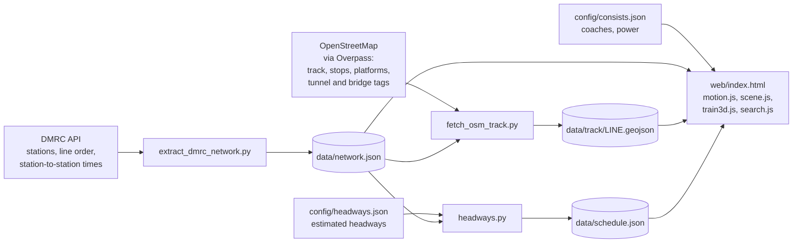

# Delhi Metro, scheduled, in 3D

A browser map of the whole Delhi Metro with every train running to a timetable: trains in 3D on
their viaducts and in their tunnels, at their real stations, built from DMRC's own station and
run-time data and OpenStreetMap's track. **The timetable is an estimate, not DMRC's**: no
published timetable exists, so train positions are modelled.

**Live:** [kitteshwar.github.io/delhi-transit-map/web/](https://kitteshwar.github.io/delhi-transit-map/web/)

## Features

- **Every DMRC line**: all 13 passenger line codes in DMRC's API, Airport Express and Rapid
  Metro Gurugram included. Noida's Aqua Line is run by NMRC and not included.
- **Trains on a schedule**: each train accelerates and brakes at 1 m/s², waits 25 s at each
  station and keeps to DMRC's station-to-station times. Pink Line trains go round the ring
  continuously. A time slider, 1x to 300x speed, weekday, Saturday and Sunday timetables, and a
  Now button.
- **The line in 3D**: viaducts 12 m up with piers, tunnels 16 m down seen through the map, lines that
  cross at the same level 10 m over or under each other (in the order OSM's layer tags give), ramps
  between them, broad-gauge rails on sleepers, overhead wires and masts, and a third rail for Rapid
  Metro. Curves are rounded so wheels follow the rails.
- **Trains like DMRC's**: stainless-steel cars with a rounded cab, the DMRC logo, a band in the
  line's colour, pink door panels on the women's coach, pantographs, and lamps lit at the front and
  red at the back. Doors slide open on the platform side while a train stands at a station. Each line runs its real number of coaches (see the table).
- **Stations**: platforms with a yellow edge strip, columns under an arched roof, a concourse on
  piers under the raised ones, and street entrances for the underground ones. At interchanges a
  walkway and lift towers sketch how the lines' platforms join (stacked platforms by one tower, two
  raised stations by a glazed foot bridge, others by a covered way along the street or a passage
  underground; the real passages are not mapped), and
  the station's popup gives DMRC's walking time for each change.
- **Find a station**: search by name, OSM spelling or code, or click one, and the map flies there.
- **Live from where you are (optional)**: tap "I'm at a station" when your train pulls in, or
  "I'm on a train" to follow it by GPS, and the map runs that train as late or early as it really
  is. Your location is read only after you tap and never leaves your browser.
- **Fast**: simple cars when zoomed out; closer in, only cars in view are drawn in full. Rails are
  built only near the view. It renders at the screen's refresh rate, with an fps readout.
- **Phone layout**: the panel folds away to leave the screen to the map.

## Where the data comes from



| Source | What it gives | Where it lands | As of |
|---|---|---|---|
| DMRC's website API (undocumented) | 254 stations, each line's station order, station-to-station run times | `data/network.json` | 2026-11-17 |
| OpenStreetMap, through Overpass | Track geometry, stop positions, platform outlines, tunnel and viaduct stretches | `data/track/*.geojson` | 2026-11-24 (Blue Line 2026-11-18) |
| DMRC press releases, Wikipedia | Coaches per train, third-rail power on Rapid Metro | `config/consists.json` (sources inside) | 2026-11 |
| DMRC press releases, then estimates | First and last trains, the 2 min 18 s peak headway, every other headway | `config/headways.json` (sources inside) | 2026-11 |

Viaduct height, tunnel depth, platform and car sizes are typical values, not surveyed.

## The network in numbers

| Line | Code | Stations | Length (km) | Viaduct | Tunnel | At grade | Coaches | Power | End to end (min) | Peak headway (s) | Trains at weekday peak |
|---|---|--:|--:|--:|--:|--:|--:|---|--:|--:|--:|
| Red Line | LN1 | 29 | 33.6 | 28.8 | 0.2 | 4.5 | 8 | 25 kV overhead | 58 | 180 | 40 |
| Yellow Line | LN2 | 37 | 47.8 | 24.4 | 23.2 | 0.2 | 8 | 25 kV overhead | 83 | 138 | 74 |
| Blue Line | LN3 | 50 | 55.6 | 50.4 | 3.4 | 1.9 | 8 | 25 kV overhead | 107 | 138 | 94 |
| Blue Line | LN4 | 8 | 8.4 | 7.8 | 0.0 | 0.6 | 8 | 25 kV overhead | 17 | 276 | 8 |
| Green Line | LN5 | 22 | 24.8 | 24.8 | 0.0 | 0.0 | 4 | 25 kV overhead | 45 | 300 | 20 |
| Violet Line | LN6 | 34 | 44.9 | 30.8 | 14.1 | 0.0 | 6 | 25 kV overhead | 78 | 180 | 54 |
| Pink Line | LN7 | 43 | 67.7 | 48.2 | 18.1 | 1.4 | 6 | 25 kV overhead | 117\* | 300 | 46 |
| Pink (Ext.) | LN7EXTN | 4 | 4.2 | 4.2 | 0.0 | 0.0 | 6 | 25 kV overhead | 6 | 600 | 2 |
| Magenta Line | LN8 | 26 | 38.2 | 13.9 | 24.0 | 0.4 | 6 | 25 kV overhead | 74\* | 300 | 34 |
| Magenta (Ext.) | LN8EXTN | 7 | 9.4 | 9.4 | 0.0 | 0.0 | 6 | 25 kV overhead | 11\* | 600 | 2 |
| Grey Line | LN9 | 4 | 4.9 | 2.6 | 2.1 | 0.2 | 6 | 25 kV overhead | 11 | 600 | 4 |
| Airport Express | LN10 | 7 | 23.7 | 7.6 | 16.1 | 0.0 | 6 | 25 kV overhead | 21 | 600 | 6 |
| Rapid Metro | LN11 | 11 | 12.1 | 12.1 | 0.0 | 0.0 | 3 | 750 V third rail | 21 | 240 | 12 |

- **Stations** are counted by DMRC code. Interchanges count once per line. The map has
  254 different stations.
- **Length** is one direction's track as OSM maps it. It includes the run on to terminal
  platforms, and 300 m past the end where an extension shares its parent line's route. That is
  about 375 km in all. Green Line figures are for its main route: its Kirti Nagar branch
  adds 2 stations and 1.4 km.
- **End to end** adds up DMRC's station-to-station times, one dwell each. \* One hop's DMRC time
  is implausible (2 s or 720 s), so it is replaced by its length at the line's median speed.
- **Peak headway** and **trains at weekday peak** come from the estimated timetable, not from
  DMRC. They add up to 396 trains, more than DMRC's fleet of about 350 trains
  (DMRC, Nov 2024). That shows they are guesses. The Pink Line counts each lap as one trip.

## Run it locally

```
python3 -m http.server 8765 --bind 127.0.0.1   # then open http://127.0.0.1:8765/web/
```

To rebuild the data: `extract_dmrc_network.py`, then
`fetch_osm_track.py --line LN1 --line LN2 ...`, then `headways.py`. Tests:
`python3 -m unittest discover -s tests` and `node --test tests/*.mjs`.

## Credits and licence

Track, stations and the map background (c) OpenStreetMap contributors, ODbL. Station order and
run times from DMRC. [three.js](https://threejs.org) (MIT) is in `web/vendor/`; the Hind typeface
(Indian Type Foundry, SIL Open Font License, see `web/fonts/OFL.txt`) is in `web/fonts/`;
[MapLibre GL JS](https://maplibre.org) (BSD) loads from unpkg. This project's code is GPL-3.0
(see `LICENSE`).

## extract_dmrc_network.py

Builds `data/network.json` from the JSON API behind delhimetrorail.com
(`https://backend.delhimetrorail.com/api/v2/en`, undocumented, Cloudflare wants a `Referer`).

```
python3 extract_dmrc_network.py            # ~530 requests on a cold cache, about a minute
python3 extract_dmrc_network.py --refresh  # ignore the 24 h response cache in .cache/dmrc
python3 -m unittest discover -s tests      # offline tests
```

Exit code 2 when a line has a station not reachable from its prev/next data, a hop with
no time, or a line whose hop times do not add up to the planner's end-to-end time.

### What it does

1. `station_list`, then `station/{code}` for each: coordinates, type, interchange flag,
   opening/closing hours, and the prev/next station per line.
2. Per line in `line_list`: turn the prev/next declarations into directed edges and walk
   every root-to-leaf path. One path = one **pattern**. Green Line has two (Inderlok and
   Kirti Nagar both feed Ashok Park Main). Blue is two DMRC lines (LN3 Dwarka Sec 21-Noida
   Electronic City, LN4 Yamuna Bank-Vaishali); the Vaishali trains run through onto LN3 in
   practice, which is a timetable fact, not a topology one.
3. Per adjacent pair: `station_route/{a}/{b}/least-distance/{date}`. The answer must be one
   two-stop segment on the same line. Karkardooma-Anand Vihar is adjacent on Blue *and* Pink
   and the planner always answers Blue, so the Pink hop is measured as the three-hop span
   around it minus its two known neighbours (`measured_as_span`).
4. Loops: DMRC's prev/next data leaves two loops open, the Pink ring (Maujpur-Babarpur back to
   Yamuna Vihar) and the Rapid Metro loop (Phase 3 back to Phase 2). For a single-pattern line
   the planner is asked for last -> first stop; when its first step goes to an earlier stop of
   the pattern, the pattern ends on that stop and `loop: true` is set, so Rapid Metro reads
   `S55 ... SKRP, DL2, BEL, GAT, MAL, DL3, DL2`. A loop declared in prev/next data is kept the
   same way.
5. Check: for every pattern (a loop up to its last new station), planner end-to-end time on
   that line against the sum of its hops. They match to the second, so each hop is run time plus one dwell
   (`hop_seconds_include_one_dwell`). Where the planner prefers a route over other lines the
   check is reported as not comparable.
6. Hops outside 45-600 s are kept but marked `suspect` (DMRC's data has 2 s and 720 s hops).
7. Interchanges: for each pair of lines at a station (a branch and its own line, such as LN4
   with LN3, does not count), and for Dhaula Kuan's foot bridge to Durgabai Deshmukh South Campus
   (the hidden line LN12), the planner is asked for trips from a neighbour on one line to a
   neighbour on the other until one changes there. The change takes the later legs'
   `station_interchange_time` plus the bridge walk: 5 or 10 minutes at most stations, 25 at
   Dhaula Kuan, and 0 (none given) at Haiderpur Badli Mor, Majlis Park and Madhuban Chowk.

### Output shape

```json
{
  "generated_at": "...", "source": "...", "route_date": "YYYY-MM-DD",
  "hop_seconds_include_one_dwell": true,
  "stations": {"KG": {"name": "KASHMERE GATE", "lat": 28.6675, "lon": 77.2282, "type": "Underground",
                      "interchange": true, "opening_time": "05:20:00", "closing_time": "23:47:00",
                      "lines": ["LN2", "LN1", "LN6"]}},
  "lines": [{"code": "LN2", "name": "Line 2", "color_name": "Yellow Line", "color": "#f6d71a",
             "status": "Normal Service", "dmrc_termini": ["...", "..."],
             "patterns": [["SPBI", "RISE", "..."]], "loop": false,
             "hops": [{"from": "SPBI", "to": "RISE", "seconds": 124}],
             "check": [{"from": "SPBI", "to": "HCC", "stops": 37, "sum_of_hops": 5002,
                        "planner_direct_same_line": 5002}]}],
  "interchanges": [{"from": "KG", "to": "KG", "lines": ["LN2", "LN1"], "minutes": 10.0, "via": []},
                   {"from": "DDSC", "to": "DKV", "lines": ["LN7", "LN10"], "minutes": 25.0, "via": ["LN12"]}],
  "warnings": ["..."]
}
```

Not included on purpose: platforms (DMRC only has platform numbers; `fetch_osm_track.py` gets
them from OSM),
the FOB pseudo-line as a line (hidden on the DMRC site; it appears only as an interchange) and the Badli depot pseudo-station. Hops carry no
direction: the planner runs the Rapid Metro loop one way (Phase 3 to Moulsari Avenue goes the
long way round), which network.json does not record yet.

## fetch_osm_track.py

Builds `data/track/<LINE>.geojson`: per line and direction, the track as one line with distance
along it, DMRC's stations placed on it, platform extents and the tunnel/elevated stretches. Reads
station order and hop times from `data/network.json`, so run `extract_dmrc_network.py` first.
Geometry comes from OpenStreetMap through one Overpass query.

```
python3 fetch_osm_track.py                       # Blue Line (LN3 and LN4), about a minute cold
python3 fetch_osm_track.py --line LN2 --line LN7EXTN --line LN11  # other lines
python3 fetch_osm_track.py --refresh             # ignore the 24 h answer cache in .cache/osm
```

`--line` takes any line in `data/network.json` with a known OSM route: a numbered line (`LN<n>`)
is the Delhi Metro route whose `ref` is that number, an extension (`LN7EXTN`) is found on its
parent line's routes, `LN10` is `ref=AEx` and `LN11` is network `Rapid Metro Gurgaon`, `ref=RMGL`.
Every line has been run (OSM data of 24 Nov 2026; Blue Line of 18 Nov). Exit code 2 when a pattern direction has no OSM route that pairs with it, the route's
track has a gap, a DMRC station name does not match its OSM stop, or a stop is not past the one
before it along the track. Everything else is a warning, printed and kept in the file.

### What it does

1. Fetches the Delhi Metro `route=subway` relations with that `ref`, their track ways and stop
   nodes, and every `railway=platform` / `public_transport=platform` way within 60 m of a stop.
2. Joins each relation's ways into one line in travel order and measures distance along it
   (`s`, metres). A way that does not start where the last one ended is a gap.
3. At a terminus where OSM's track ends partway along the platform (it usually stops at the stop
   node), runs the track on straight to the platform's far end. The metres added before the
   start and past the end are `extended_m`; that piece takes the tags of the way next to it.
4. Pairs a run of the relation's stop nodes with a DMRC pattern by position in the list, forward
   or reversed, whichever leaves the lowest median DMRC-to-OSM offset under 300 m. By order, not
   by distance, because a few DMRC coordinates are far off (Dwarka Mor: 812 m). Warns over 100 m.
   The run can be part of the relation: the Pink Line extension (Maujpur to Shiv Vihar) and the
   Green Line's Kirti Nagar branch share their routes with other stops. A ring (LN7 starts and
   ends at Yamuna Vihar) may start at any of its stations, and is started where OSM starts it,
   at Maujpur. The track is then cut to 300 m either side of the run's first and last stop.
   A station whose OSM name differs from DMRC's but whose position matches is listed in
   `OSM_NAMES` and not reported (DMRC's North Pitampura is OSM's "Haiderpur Village", 170 m off).
5. For each stop, the platform within 30 m of its node, as `s_start`-`s_end` along the track.
   Under 120 m is `partial` (OSM maps a fragment; Blue Line platforms are about 180 m).
6. Tunnel, elevated (`bridge=*`) and at-grade runs from the way tags, and per hop the track
   metres against DMRC's seconds as average km/h, warning outside 15-80 km/h. A hop that
   `network.json` marks `suspect` (DMRC gives 2 s or 720 s) gets its track metres at the
   direction's median hop speed instead, marked `estimated` (LN8 Krishna Park Extension to
   Janakpuri West: 720 s replaced by 248 s for 2,250 m).

### Output shape

A GeoJSON FeatureCollection; open it in geojson.io or QGIS to check it by eye. Values below are
real ones from LN3 and LN4, shortened.

```json
{
  "type": "FeatureCollection", "generated_at": "...", "osm_base": "...", "attribution": "...",
  "warnings": ["..."],
  "features": [
    {"geometry": {"type": "LineString", "coordinates": [[77.058427, 28.55201], "..."]},
     "properties": {"kind": "track", "line": "LN3", "pattern": 0, "direction": "forward",
                    "from": "DSTO", "to": "NECC", "osm_relation": 8037669, "osm_name": "...",
                    "length_m": 55644.0, "extended_m": [0.0, 0.0], "s": [0.0, 420.8, "..."],
                    "structure": [[0.0, 1027.4, "tunnel", -2], "..."],
                    "hops": [{"from": "DSTO", "to": "DSET", "track_m": 1751.1, "seconds": 181, "avg_kmh": 34.8}]}},
    {"geometry": {"type": "Point", "coordinates": [77.267951, 28.623307]},
     "properties": {"kind": "stop", "line": "LN4", "pattern": 0, "direction": "forward", "seq": 0,
                    "code": "YB", "name": "YAMUNA BANK", "osm_name": "Yamuna Bank",
                    "osm_node": 5737168028, "s": 97.5, "dmrc_offset_m": 5.1,
                    "platform": {"osm_way": 696173227, "s_start": 0.0, "s_end": 179.3, "length_m": 179.3, "partial": false}}}
  ]
}
```

`direction` is relative to the DMRC pattern: `forward` runs the pattern's stops in order, and
`reverse` runs them back. `platform` is `null` where OSM maps none.

Blue Line as of OSM data from 18 Nov 2026: LN3 55.6 km (3.4 km tunnel, 50.4 km elevated) with a
full platform at 6 of 50 stations; LN4 8.4 km with 3 of 8. Stop nodes sit mid-platform (83-106 m
from a platform end), so a train's front stops about half a train length past its stop node.

Track, stops and platforms are (c) OpenStreetMap contributors under the ODbL: credit OSM wherever
they are shown or published.

## headways.py

Builds `data/schedule.json`, the terminal departure times for each line, direction and day type,
from the estimated profile in `config/headways.json`. A key like `LN5:1` is a line's second DMRC
pattern (the Green Line's Kirti Nagar branch). It also prints how many trains the profile keeps
running at once, to check against the real fleet.

```
python3 headways.py
```
